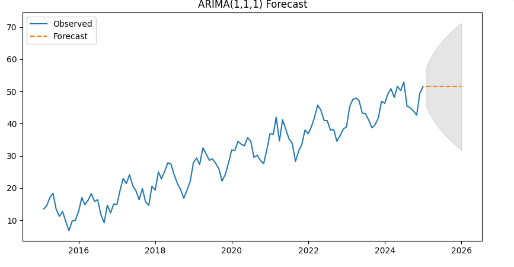

# Experiment 6: ARIMA Model for Forecasting

## Aim

To evaluate predictive models using performance metrics.

## Algorithm

1.  **START**
2.  Prepare stationary time series.
3.  Identify ARIMA -- (p, d, q) parameters using ACF/PACF.
4.  Fit the ARIMA model on the data.
5.  Forecast future periods and plot the results.
6.  Evaluate forecast accuracy.
7.  **STOP**


## Program
```python
# Step 1: Import required libraries
import numpy as np
import pandas as pd
import matplotlib.pyplot as plt
from statsmodels.tsa.arima.model import ARIMA
from statsmodels.tsa.stattools import adfuller

# Step 2: Generate synthetic time series data
np.random.seed(42)
periods = 120
time = pd.date_range(start='2015-01-01', periods=periods, freq='M')

trend = np.linspace(10, 50, periods)
seasonal = 5 * np.sin(2 * np.pi * time.month / 12)
noise = np.random.normal(0, 2, periods)

series = pd.Series(trend + seasonal + noise, index=time)

# Step 3: Difference the series to remove trend
series_diff = series.diff().dropna()

# Step 4: Fit ARIMA model (p=1, d=1, q=1)
model = ARIMA(series, order=(1, 1, 1))
model_fit = model.fit()

# Step 5: Display ARIMA model summary
print(model_fit.summary())

# Step 6: Generate 12-month forecast
forecast = model_fit.get_forecast(steps=12)

# Step 7: Create forecast date index
forecast_index = pd.date_range(
    start=series.index[-1] + pd.offsets.MonthEnd(1),
    periods=12,
    freq='M'
)

# Step 8: Extract forecast values and confidence intervals
forecast_mean = pd.Series(
    forecast.predicted_mean,
    index=forecast_index
)

conf_int = forecast.conf_int()

# Step 9: Plot observed data and forecast
plt.figure(figsize=(10, 5))

plt.plot(series, label='Observed')
plt.plot(forecast_mean, label='Forecast', linestyle='--')

plt.fill_between(
    forecast_index,
    conf_int['lower y'],
    conf_int['upper y'],
    color='gray',
    alpha=0.2
)

# Step 10: Add graph labels and display output
plt.legend()
plt.title('ARIMA(1,1,1) Forecast')
plt.show()
```
## Output
```text
SARIMAX Results                                
==============================================================================
Dep. Variable:                      y   No. Observations:                  120
Model:                 ARIMA(1, 1, 1)   Log Likelihood                -303.499
Date:                Sat, 21 Nov 2026   AIC                            612.997
Time:                        15:26:02   BIC                            621.335
Sample:                    01-31-2015   HQIC                           616.383
                         - 12-31-2024                                         
Covariance Type:                  opg                                         
==============================================================================
                 coef    std err          z      P>|z|      [0.025      0.975]
------------------------------------------------------------------------------
ar.L1         -0.4167      0.820     -0.508      0.612      -2.025       1.191
ma.L1          0.3230      0.864      0.374      0.708      -1.369       2.015
sigma2         9.6103      1.544      6.225      0.000       6.584      12.636
===================================================================================
Ljung-Box (L1) (Q):                   0.03   Jarque-Bera (JB):                 2.24
Prob(Q):                              0.86   Prob(JB):                         0.33
Heteroskedasticity (H):               1.02   Skew:                             0.02
Prob(H) (two-sided):                  0.96   Kurtosis:                         2.33
===================================================================================
```


## Result
Thus, the ARIMA (1,1,1) time series forecasting model was successfully implemented using Python. The model generated a 12-month forecast, and the observed data, predicted values, and confidence intervals were visualized using Matplotlib.
